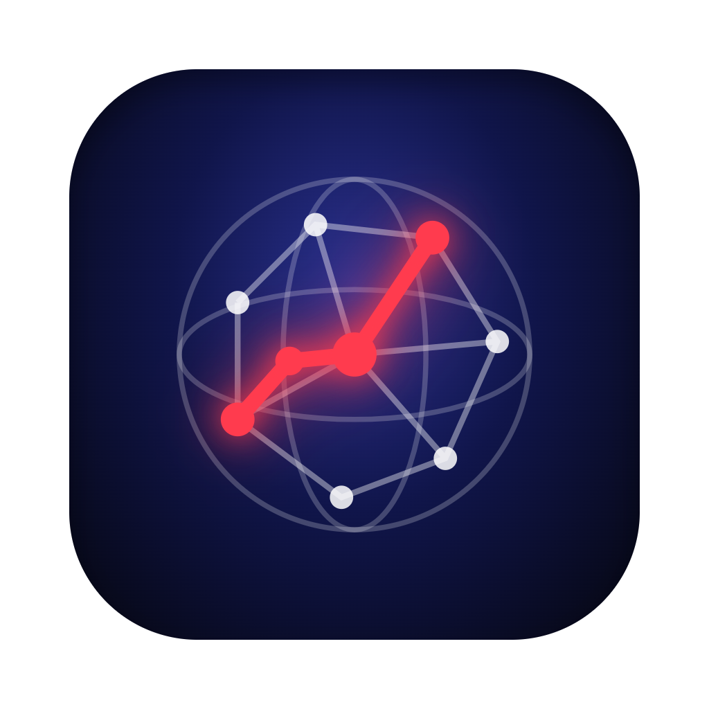
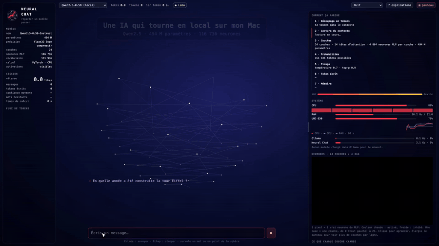

# Neural Chat



[](media/neural-chat-demo.mp4)

▶ **[Voir la démo complète (44 s, avec son)](media/neural-chat-demo.mp4)**

Une app macOS pour discuter avec des modèles d'IA en local et **voir ce qu'ils font pendant qu'ils écrivent** : confiance sur chaque mot, attention, neurones, ressources de la machine. Tout tourne sur ton Mac, rien ne part dans le cloud.

## Deux modes

**Ollama** : tes modèles Ollama (qwen2.5, qwen3…).
- Chaque mot de la réponse est souligné quand le modèle hésite (orange) ou devine (jaune). Au survol : sa confiance et les mots qu'il a failli écrire (logprobs).
- La sphère est une carte de la réponse : un point par passage, du début (haut) à la fin (bas), en jaune là où le modèle devinait.
- Le raisonnement des modèles qui « réfléchissent » (qwen3, deepseek-r1) s'affiche en gris.

**Labo** : un petit modèle (Qwen2.5-0.5B) lancé directement avec PyTorch, pour lire son état interne à chaque token.
- La sphère dessine la vraie attention : un point par token, des traits vers les mots que le modèle regarde pour écrire le suivant.
- Grille des 116 736 neurones MLP (24 couches × 4 864), un pixel par neurone, avec zoom et survol.
- Ce que chaque couche change, les 5 prochains tokens possibles, l'incertitude (entropie), le tirage (température, top-p), le cache KV.

## Autour

- **Comment ça marche** : les 7 étapes d'un token, avec les vraies valeurs du modèle choisi. Bouton « ? explications » pour un texte sous chaque élément.
- **Système** : CPU (par cœur), RAM, GPU, ce qu'utilisent Ollama et l'app, modèles chargés.
- **Colonne de gauche** : fiche du modèle, statistiques de la session, flux des tokens colorés par confiance.
- **6 thèmes** : Nuit, Noir, Matrix, Synthwave, Ambre (CRT), Papier (clair).
- Panneau de droite redimensionnable (glisser son bord gauche).

## Installer et lancer

Prérequis : [Ollama](https://ollama.com) avec au moins un modèle (`ollama pull qwen2.5:7b`), Python 3.9+.

```bash
python3 -m venv --system-site-packages .venv
.venv/bin/pip install "torch==2.2.2" "numpy<2" "transformers>=4.45,<4.48" psutil pywebview
.venv/bin/python app.py            # ouvre la fenêtre
.venv/bin/python app.py --server   # sans fenêtre : ouvrir http://127.0.0.1:8766
```

Le modèle du Labo (~1 Go) se télécharge au premier lancement. Sans PyTorch, l'app marche quand même en mode Ollama.

`index.html` fonctionne aussi seul, sans le serveur (modes Ollama et démo). Ouvert par double-clic (`file://`), Ollama refuse la connexion par défaut : lancer `launchctl setenv OLLAMA_ORIGINS "null"` puis relancer Ollama, ou le servir avec `python3 -m http.server`.

## Fichiers

| Fichier | Rôle |
|---|---|
| `index.html` | Toute l'interface : sphère, chat, panneaux, thèmes |
| `app.py` | Serveur local (port 8766) + fenêtre native (pywebview) |
| `lab.py` | Mode Labo : le modèle PyTorch et la lecture de ses activations |
| `sysmon.py` | Moniteur CPU, RAM, GPU et modèles Ollama |

La config (URL d'Ollama, prompt système, modèles par défaut, thèmes) est en haut du script de `index.html`.

## Brancher la sphère ailleurs

```js
neural.pulse(3, 0.9)    // 3 influx, confiance 0..1
neural.think(true)      // mode réflexion
neural.setActivity(0.5) // activité 0..1
```
